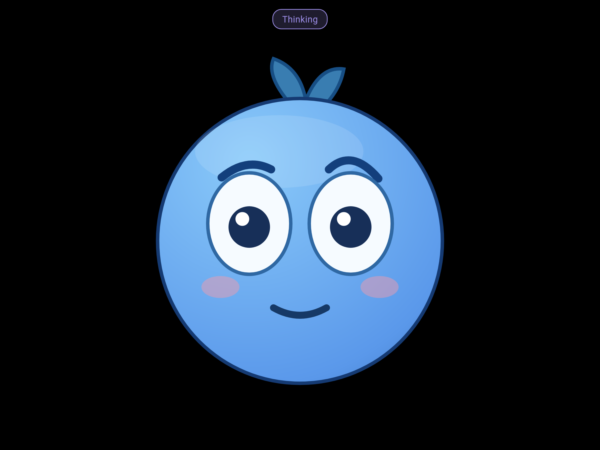
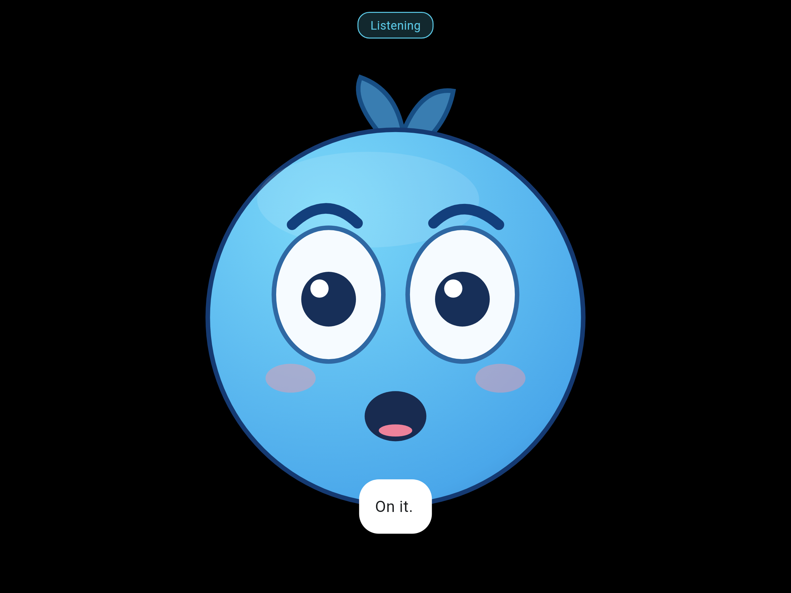
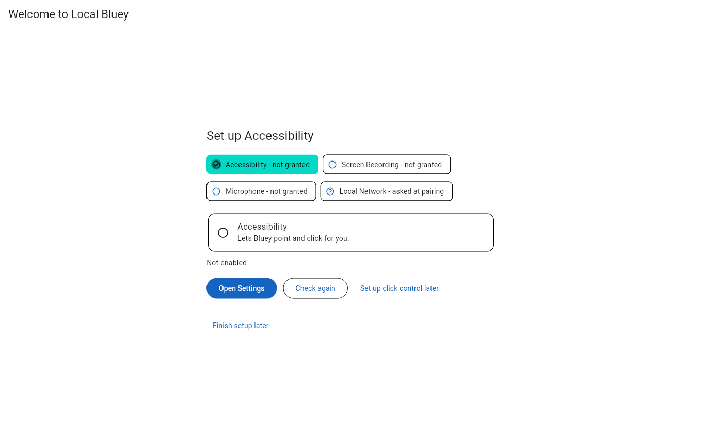

# Local Bluey

A blueberry character who lives on your iPhone under your Mac's screen and points at things with his own big cursor - now as a **Flutter app** for **macOS, iOS and Android** that can run **fully locally**. Forked from [rbrown101010/bluey-by-riley](https://github.com/rbrown101010/bluey-by-riley) and rebuilt: the hardcoded OpenAI Realtime WebSocket is gone, replaced by a modular brain that talks to local [Ollama](https://ollama.com) or any OpenAI-compatible API (OpenRouter, LocalAI, OpenCode…).

[](https://github.com/shpalac/local-bluey/actions/workflows/ci.yml)

**How it feels:** double tap his face to wake him. **Press and hold** to ask something; let go and he answers in a speech bubble. Ask "what's this?" and he points at whatever is under your mouse. Double tap again and he goes back to quietly following your pointer with his eyes.

**Using the computer:** when you ask, he can click, type, press shortcuts, scroll, drag, zoom into a region of the screen, wait for something to appear, and open apps and websites - with his own cursor, while your real pointer is put back where you left it. Needs Accessibility permission on the Mac.

## Screenshots

<table>
  <tr>
    <td></td>
    <td></td>
  </tr>
  <tr>
    <td></td>
    <td></td>
  </tr>
  <tr>
    <td></td>
    <td></td>
  </tr>
  <tr>
    <td></td>
    <td></td>
  </tr>
  <tr>
    <td colspan="2"></td>
  </tr>
</table>

These are deterministic mock captures: fake data, a pinned font and window size, no real Mac window, permission prompt or device. They come from the screenshot harness (`tool/regenerate_screenshots.sh`, see [#180](https://github.com/shpalac/local-bluey/issues/180)); the Hebrew strings still need a native-speaker review. The 200% text captures show the initial scrollable viewport, which can end mid-card; they are not proof of complete layout. The harness also scrolls each action into view and asserts it sits fully inside the window with no overflow, and the scrolled-bottom captures [English](docs/screenshots/onboarding-compact-dark-200-bottom.png) and [Hebrew](docs/screenshots/onboarding-he-dark-200-bottom.png) show the end of the same screens. Font sources, versions, hashes and licenses are in [docs/FONTS.md](docs/FONTS.md). Real-device captures are tracked separately in [#15](https://github.com/shpalac/local-bluey/issues/15).

## Status

- **Platforms today:** macOS (the host that sees and controls the computer) and iOS + Android (the phone clients). App roles are chosen by capability through a support matrix, not `Platform.isMacOS`, and platforms with no supported role (Linux, Windows) get an explicit unsupported screen instead of a broken UI. Computer control is native on macOS; Linux has experimental X11 and Wayland backends (see below) and Windows has none yet. The full matrix is in [docs/SUPPORT.md](docs/SUPPORT.md).
- **Android:** a phone client only (same role as iOS: hold-to-talk and the Mac link). CI builds a debug APK and runs `integration_test/` on an Android emulator (API 29 and 34); the native MethodChannel is mocked there, so this checks the Dart side only. It has not been tested on a real device yet.
- **Linux:** an experimental, best-effort host. There is an X11 backend (`lib/services/linux_x11_host_control.dart`, using `import` and `xdotool`) and a Wayland portal path, but [docs/SUPPORT.md](docs/SUPPORT.md) still lists Linux as an unsupported role in the app, and none of it has run on a real desktop. CI builds the release bundle, packages a tarball, and runs a phone-to-host test over loopback TCP against Xvfb (`test/e2e_phone_host_test.dart`). [docs/LINUX_HOST_SPIKE.md](docs/LINUX_HOST_SPIKE.md) has the background.
- **Implemented:** Ollama and OpenAI-compatible brains, a settings screen, transcription and spoken answers over OpenAI-compatible HTTP endpoints, native tool calling, screenshot vision with zoom, a safety gate with confirmations and a kill switch, a local-only mode with screen-text redaction, a persistent action log and a data-egress report, unified data deletion and retention controls, conversation memory summaries, retry with backoff on dropped requests, onboarding with live permission checks, English/Hebrew UI with RTL and light/dark appearance, personality with moods and selectable characters, routines (user-defined macros), haptics on the phone client, empty/error/undo patterns, offline-first graceful degradation, optional biometric app lock, suggestions and search over past answers, and Mac-to-phone hold-to-talk over the local network.
- **Not done yet:** see the open [issues](https://github.com/shpalac/local-bluey/issues), including a real on-device wake-word spotter ([#79](https://github.com/shpalac/local-bluey/issues/79)) and real-device validation ([#15](https://github.com/shpalac/local-bluey/issues/15)). Nothing here has been verified on real hardware: the emulator and Xvfb runs use mocked or loopback boundaries. The first hardening pass from the code review (tracker [#124](https://github.com/shpalac/local-bluey/issues/124): kill switch, link authentication, recordings, local-only enforcement) is merged; follow-ups are in the issue list.

## Privacy: what stays local

The brain and speech use their configured endpoints; speech can fall back to the brain URL. Transcription uses separate saved STT settings and does not fall back to the general brain URL. On first STT load, saved legacy transcription URL/model and an available legacy brain key are copied once into the STT settings. Later edits to the current Settings transcription form change only those legacy fields, not the active STT settings. There is no supported STT provider picker in that form today. HTTP transcription needs an explicit saved endpoint and a server that supports the audio-transcription contract; an Ollama chat endpoint alone does not provide that. Native transcription is a not-installed placeholder, not an available offline backend. A configured STT readiness check does not test reachability, credentials, model or language support.

Each service has its own endpoint choice. Local-only mode is a separate privacy setting; a local brain alone does not make transcription, speech or screen-watch requests local. If you configure a remote endpoint, the requests that use it can send prompts, recorded audio or screenshots to that provider. See [current STT configuration limits](docs/USER_GUIDE.md#transcription-configuration-and-limits) and the source audit [STT readiness remainder](docs/STT_READINESS_REMAINDER.md).

- **Local-only mode** (setting): refuses any brain, transcription or speech endpoint that is not loopback (`localhost`, `127.x.x.x`, `0.0.0.0`, `::1`). `.local` names resolve off-device, so they do not count as local (#120, #121).
- **Redaction:** screen text is scrubbed of email addresses, 16-digit card numbers and 9-digit numbers before it reaches the brain. This is pattern matching, so it is not a guarantee. When the screen text matches a pattern, the screenshot and any zoom crop of that screen are withheld too, since the pixels would show the same data (#122). A full screen without a pattern match is still sent as an image when the brain asks for one. Live zoom crops require successful OCR of the exact captured image before their pixels are sent (#245). Missing or failed crop evidence is withheld, even after a clean preceding snapshot; a successfully checked blank crop is allowed. Linux X11 zoom verifies OCR from its own captured image only when the helper succeeds with validated TSV, including a valid blank result. Missing/failed helpers, malformed output or discarded low-confidence words leave crop evidence unknown and pixels withheld. Injected fixtures check this contract and cleanup; real-X11 OCR/capture evidence is still pending. Wayland crop remains unimplemented. These OCR and regex checks can still miss secrets. Deterministic bridge/executor fixtures do not validate Vision OCR or screen capture on a real Mac; native build and real-screen window-switch/update checks remain required.
- **Voice recordings:** hold-to-talk captures are deleted after use, leftovers are swept on start, and a recording stops after 2 minutes (#116, #117).
- **Egress report:** Settings > Data and privacy shows a verifiable record of what was sent, where and when, plus an offline self-test. Retained destination hosts use the same loopback-only policy as endpoint URLs; `.local`, malformed and unknown hosts are not confirmed on-device, with no DNS lookup. This describes bounded recorded history, not proof that no unrecorded transmission occurred. Retained metadata is loaded at startup and before the first record; record/load/delete operations are ordered so completed deletion cannot be undone by an older write. Missing storage means no retained entries, not proof of no historical transmission. Unreadable or partly corrupt history is reported as unavailable/incomplete and is not overwritten until successful explicit deletion ([#58](https://github.com/shpalac/local-bluey/issues/58)).
- **Conversation history:** Recovery finishes before appending. Load/add/delete share one ordered queue with up to 200 retained turns. Completed deletion cannot be undone by older store calls, but a request that calls add after deletion is fresh store work and may persist. Missing history is distinct from unreadable/malformed history; ordinary adds preserve unknown or partly corrupt bytes, and deletion failures are reported. No new transcript/redaction policy is implied.
- **Action history:** Retained actions load at startup and before recording. Record/load/delete share one ordered queue; completed deletion cannot be undone by older writes. Up to 500 entries / 30 days are retained. Caller arguments are detached and bounded (8 KB string budget, 128 nodes, depth 4); results and guidance are bounded too. These limits are not secret detection. Unreadable or partly corrupt history is reported and left on disk until explicit deletion. No new history UI or telemetry is added.
- **API keys:** stored with `flutter_secure_storage` (Keychain on macOS and iOS), not in plain preferences.

## Safety

Tools that change your machine (`click`, `type_text`, `press_keys`, `scroll`, `drag`, `open_app`, `open_url`) ask for confirmation first, and `open_app` can be limited to an allowlist. A global kill switch cancels actions in flight (#107). An optional biometric app lock (Touch ID / Face ID / device biometrics) can gate the app. The Mac-to-phone link no longer sends the pairing key: the Mac issues a nonce and the phone answers with an HMAC of it, and the Mac shows one pairing prompt at a time (#111, #112). The link is still plain TCP on the local network, so treat it as trusted-network only.

## Docs

- [docs/USER_GUIDE.md](docs/USER_GUIDE.md) - gestures, voice flows, tools, safety and privacy for people using the app
- [CONTRIBUTING.md](CONTRIBUTING.md) - dev loop, PR conventions, test expectations
- [docs/architecture.md](docs/architecture.md) - the layers and data flow
- [docs/dev-setup.md](docs/dev-setup.md) - per-platform setup and device checklist
- [Landing page](docs/index.html) (serve the repo with GitHub Pages from /docs)

## Architecture

| Layer | Tech | What it does |
|---|---|---|
| UI | Flutter (Dart) | His face, gestures, speech bubble, menu-bar tray (macOS) |
| Brain | `lib/llm/` | `OllamaProvider` (local `/api/chat`) or `OpenAiCompatibleProvider` (any `/chat/completions` endpoint) |
| Tools | `lib/services/tool_executor.dart` | Runs the 14 tool calls (`look_at_screen`, `zoom_screen`, `wait`, `point_at`, `click`, `type_text`, …) the LLM emits |
| Native bridge | Flutter MethodChannel → Swift | ScreenCaptureKit + Vision OCR, Accessibility controls, CGEvent mouse/keyboard |
| Phone ↔ Mac | Bonjour (`nsd`) + newline-delimited JSON over TCP | The phone finds the Mac on the local network and mirrors his face |

The original Swift implementation is kept under `Mac/`, `iOS/` and `Shared/` as reference for the port.

## Run it

Requirements: Flutter (stable, Dart SDK ^3.13.5), a Mac for the desktop app, and either Ollama or an OpenAI-compatible endpoint. A phone is optional and needs to be on the same network as the Mac.

```bash
flutter pub get
flutter run -d macos   # the Mac app (grants Accessibility + Screen Recording on first use)
flutter run -d ios     # the iPhone app - it finds the Mac over Bonjour
flutter run -d android # the Android app - same discovery and hold-to-talk
```

No API keys in the repo: Ollama needs none; remote endpoints are configured in the app.

## Local data and retention

Everything the app stores lives on this device; Settings > Data and privacy lists each store with a clear button, and "Delete all local data" returns the app to first-run state (it does not touch your remote provider account data).

| Store | Where | Retention |
| --- | --- | --- |
| Conversation history + summary | Documents/conversation.json | Until deleted |
| Action log | Documents/actions.jsonl | 500 entries / 30 days |
| Egress record | Documents/egress.jsonl | 300 entries / 30 days |
| Routines | Documents/routines.json | Until deleted |
| Perf samples | Documents/perf.jsonl | Until deleted |
| Settings (API key in Keychain) | SharedPreferences + secure storage | Until deleted |
| Character, language, onboarding, safety, privacy, wake-word, app lock, haptics, notifications, theme, pairing/link keys | SharedPreferences | Until deleted |

### Spoken-reply retry cache (#255)

The host keeps retry packets only in memory: at most 20 replies, 8 MiB of
UTF-8-encoded base64 audio plus packet text and spoken text, and 2 minutes
from first delivery. All three limits apply, including to a single reply.
At the age boundary the payload is released even if no new reply arrives.
Acknowledgement cancels the receipt timer but does not extend retry eligibility.
An oversized reply is still delivered once with its speech id, but is not
cached for retry. The cache holds detached read-only packet snapshots and
returns fresh retry packets, so mutating a sent or retry packet cannot enlarge
the retained payload after its bytes are counted. Expired/evicted ids cannot restart receipt timers; eviction
cancels any associated timer. Missed-receipt history keeps at most 20 short
lines, without retaining audio just for diagnostics. Host disposal releases
packets, text, history and timers.

Encoded payload bytes are a deterministic cache budget, not process-memory
measurements: Dart string/object overhead and playback buffers are separate.
Named-host repeated-turn memory evidence for #255 is still pending. To record
it, name the host, OS and app revision; use a paired phone and repeat a fixed
number of audio turns with immediate acknowledgements. Record turn count,
cache count/bytes and process memory before, during, and after the 2-minute
idle expiry, plus the observation method. Do not infer measured process-memory
stability from deterministic tests alone. This check needs a separately
approved host run; no hardware observation is claimed here.

## Development

- `flutter test` - unit + widget tests (tool-call parsing, executor math, protocol round-trips)
- `flutter test integration_test` - E2E: hold-to-talk → mock LLM → tool call through the MethodChannel
- CI (GitHub Actions, `.github/workflows/ci.yml`; skipped for docs-only and `.md` changes): `ubuntu-latest` lanes for format and analyze, unit and widget tests with coverage floors (`tool/check_coverage.dart`), a debug APK build, Android emulator integration tests (API 29 and 34, mocked native boundary), Linux (tests, an Xvfb phone-to-host test, release build, tarball), a dependency vulnerability scan (pinned OSV binary, also weekly on schedule), secrets scans, and a pinned-actions, actionlint and zizmor lane. All lanes run in parallel (no gating between the fast and build lanes). Two `macos-latest` jobs build the macOS app and the iOS app (`--no-codesign`) concurrently. A self-hosted macOS lane (`flutter test integration_test -d macos`) only runs when `ENABLE_NATIVE_VALIDATION` is set. Actions are pinned by SHA, permissions are least-privilege, and the workflow sets `shell: bash` so piped log steps (`| tee`) fail when the command fails (#142).

## OS integration (#91)

The current app has a validated URL parser, but does not register the `localbluey` scheme or consume/dispatch incoming URLs. These examples describe parsed action identifiers, not working Shortcuts, microphone, answer, kill-switch or status entry points. There is no text-request admission path bound to the parser. See the [OS entry-point audit](docs/OS_ENTRYPOINT_REMAINDER.md) for the source inventory and remaining decisions; this is source review, not a reproduced OS launch failure.

The parser accepts only canonical lowercase `localbluey://action` (no trailing slash, extra path, userinfo, port or fragment). Non-ask actions take no query. Ask accepts exactly one literal `text` key and no other fields; percent-encode UTF-8 text (`+` means space). Malformed encoding and ambiguous/alternate path forms return null. Encoded input is capped at 8192 ASCII code units and decoded ask text at 2048 UTF-8 bytes; whitespace-only asks are rejected and valid text is preserved unchanged. Parsed identifiers (validated in `lib/services/deep_links.dart`):

- `localbluey://wake` / `localbluey://sleep` - parsed wake/sleep identifiers
- `localbluey://ask?text=<question>` - parsed ask identifier and required text
- `localbluey://stop` - parsed stop identifier
- `localbluey://mute` - parsed mute identifier
- `localbluey://status` - parsed status identifier

Parsing changes no app state and enforces neither tool safety nor native permissions. Any future dispatch needs selected request/queue, safety/confirmation, logging, role/lock and lifetime contracts; none is activated here. To wake or sleep now, double tap the face. Tray Ask Bluey wakes; it is not text ask. Tray Stop engages the safety kill switch and resets hold-key intent; Resume lifts the kill switch. Generation fences reject stale request/tool work, but do not physically cancel every entered native or network effect. Screen-watch Stop and speech Mute are separate controls.

The macOS tray offers quick actions: Ask Bluey (wake), Mute replies, Status, plus Show/Hide/Stop/Resume/Quit.

Mac hold-to-talk key (#228): in Settings, switch on "Hold a key to talk" to hold a key alone from any app (default Right Command, 400 ms; Left Command, Right Option and Fn/Globe also offered), release to send, Esc to cancel. Off by default. It needs the macOS Input Monitoring permission; without it the switch stays on but the shortcut does nothing and Settings says why. Any other key during the hold cancels it, so Cmd+C and Cmd+Tab are untouched. Works on the Mac alone, no phone needed. System-wide capture and the sandbox entitlements are not yet verified on a real Mac.

Platform limits: incoming URL registration/consumption/dispatch and iOS App Intents/Shortcuts/widgets are not delivered in the reviewed current app sources. Native registration and device validation remain separate follow-up work; parser tests prove no OS launch, permission or native shortcut behavior.


### App-lock regression and visual fixtures (#298)

App lock remains off by default. Enabling it first requires successful device
authentication and a successful preference save. Enabled gates hide content
when backgrounded and require an explicit Unlock after returning; they do not
automatically restart OS prompts on resume. Results from an attempt invalidated
by backgrounding or disposal cannot unlock the gate. Missing device credentials,
transient errors and incomplete authentication keep the gate locked with
localized guidance and retry, never a bypass to Settings.

Deterministic injected fixtures live in `test/lock_gate_test.dart` and
`test/biometric_lock_test.dart`. To capture actual English/Hebrew lock-state
pixels on CI, run:

```bash
flutter test test/lock_gate_test.dart --dart-define=LOCK_CAPTURE_DIR=build/lock-captures
```

The runner needs a Hebrew-capable font at
`/usr/share/fonts/truetype/dejavu/DejaVuSans.ttf`, or supply its path through
`--dart-define=LOCK_CAPTURE_FONT=...`. Upload `build/lock-captures/*.png` and
inspect those pixels for wrapping, clipping, readability and RTL before calling
the UI ready. These injected fixtures do not establish native biometric or
real-device acceptance.

Request lifecycle fixtures (#305): settings/STT loading, transcription, brain,
confirmation, tools and synthesis share one whole-job deadline and generation
checks. Stop/kill+resume discards late stream/reply/confirmation/audio results
before future actions or publication. Timeouts do not abort underlying native
or network computation, and already-published text/actions are not undone.
Recordings are cleaned when the runner settles. Parent #199 retains native,
provider/readiness and real-device acceptance gates.
