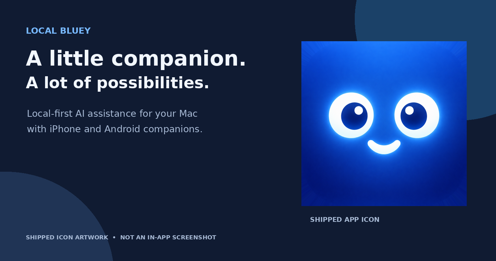
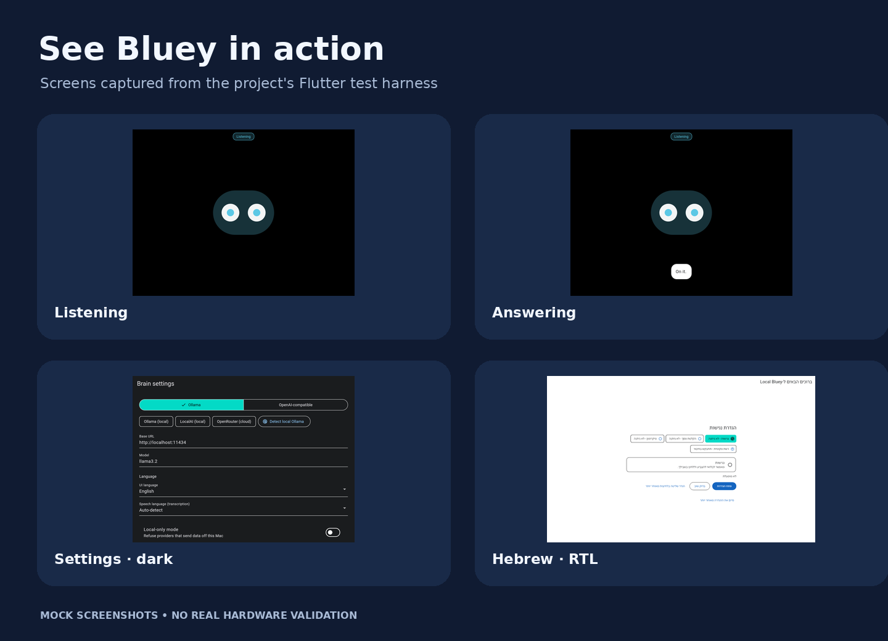
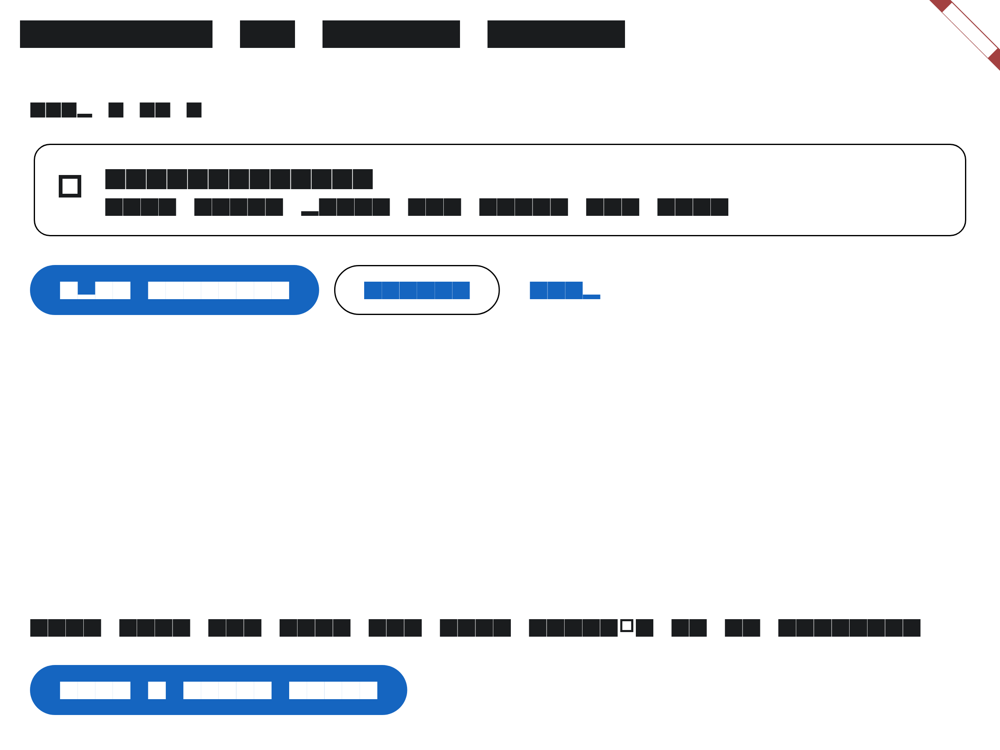
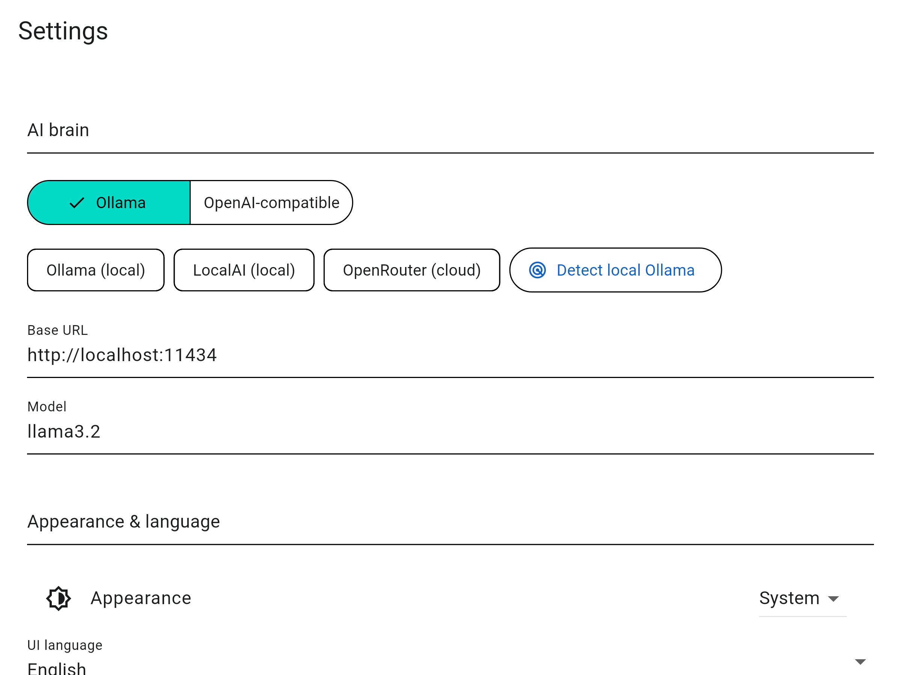
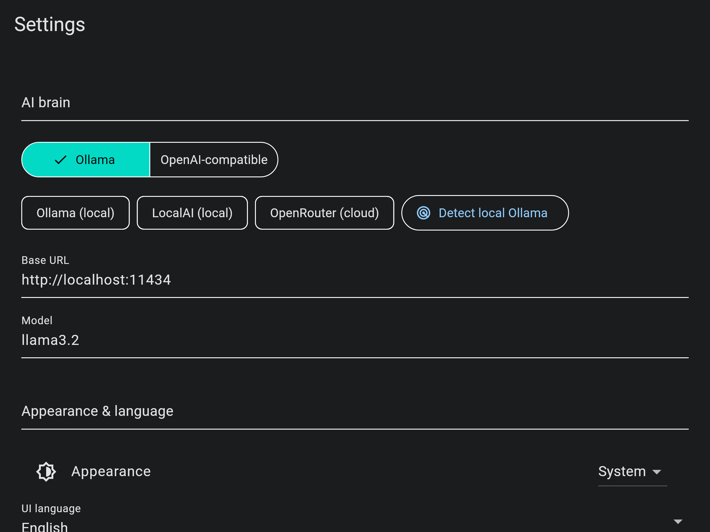
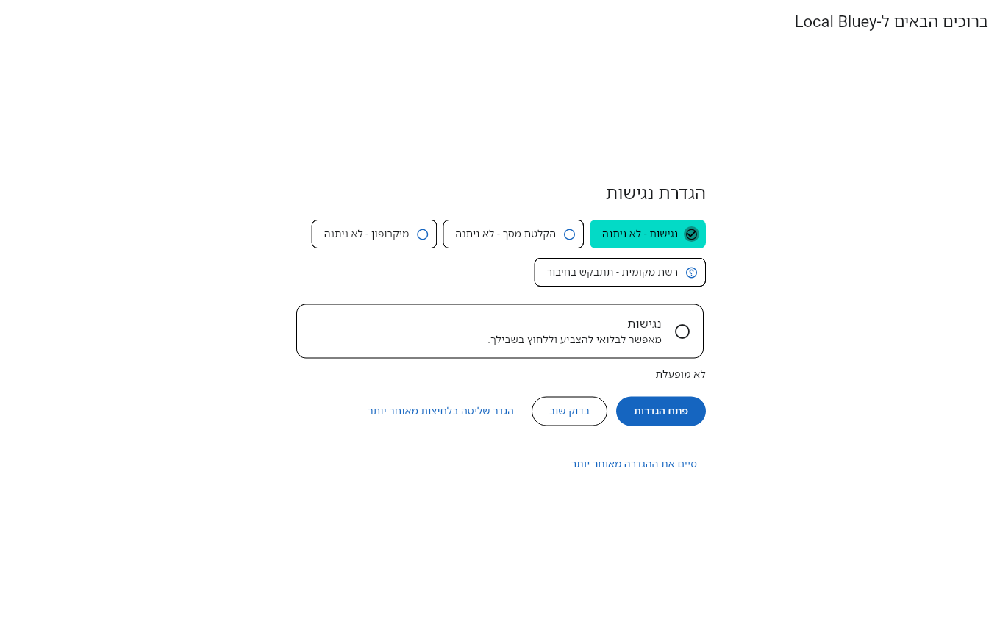

<div align="center">

# 🫐 Local Bluey

### Your little desktop companion. Your computer, your rules.

**A playful, local-first AI assistant for your Mac — with iPhone and Android companions.**

Talk to Bluey, ask about what's on your screen, and let him help with computer tasks — with confirmation before actions that change your machine.

[](https://github.com/shpalac/local-bluey/actions/workflows/ci.yml)


**[Visit the website](https://shpalac.github.io/local-bluey/)** · **[Get started](#-quick-start)** · **[See it in action](#-meet-bluey)** · **[Features](#-what-bluey-can-do)** · **[Roadmap](#-whats-next)** · **[Documentation](#-documentation)**

</div>

---

<div align="center">
  
</div>

## ✨ Meet Bluey

<div align="center">
  
  <p><sub>Actual shipped character artwork; not an in-app screenshot.</sub></p>
</div>

Bluey is a little blueberry with a big personality and his own on-screen cursor.

1. **Double-tap** his face to wake him.
2. **Press and hold** to ask a question, then release.
3. Ask **“What's this?”** to get help with something on your Mac screen.
4. When you approve a computer action, Bluey can point, click, type, scroll, drag, or open an app.

The Mac is the **host**: it sees and controls the computer. The iPhone and Android apps are **companions** for talking to the host.

> [!IMPORTANT]
> **Project status:** Features described here are implemented in the codebase, but end-to-end operation has **not yet been verified on real hardware**. The screenshots below are deterministic mock captures, not photos of a running device. See [real-device validation #15](https://github.com/shpalac/local-bluey/issues/15).

## 🚀 What Bluey can do

<table>
<tr>
<td width="50%" valign="top">

### 🧠 Bring your own brain
Choose **local Ollama** or a configured **OpenAI-compatible endpoint**. Brain, transcription, and speech have separate configuration and privacy implications.

</td>
<td width="50%" valign="top">

### 👀 Understand your screen
Bluey can inspect a screenshot, read recognized screen text, zoom into a region, and point at an element. OCR and pattern-based redaction are **not guarantees** against exposing secrets.

</td>
</tr>
<tr>
<td valign="top">

### 🖱️ Help on your Mac
Click, type, use shortcuts, scroll, drag, and open apps or URLs through native macOS controls — with a **SafetyGate**, action confirmations, and a kill switch.

</td>
<td valign="top">

### 🎙️ Talk naturally
Hold to talk from a phone or the Mac; receive transcribed and spoken responses when compatible speech endpoints are configured. **Offline native STT is not shipped.**

</td>
</tr>
<tr>
<td valign="top">

### 🎨 Make him yours
Light and dark themes, English and Hebrew with RTL, character choices, moods, phone haptics, and optional biometric app lock.

</td>
<td valign="top">

### 🔁 Remember and repeat
Conversation summaries, past-answer search and suggestions, plus **user-defined Routines**. Automatic activity learning and Teach Mode are **future work**, not shipped features.

</td>
</tr>
</table>

## 📸 A closer look

<div align="center">
  
</div>


<div align="center">
<table>
<tr>
<td align="center" width="50%"><br><sub>Guided onboarding</sub></td>
<td align="center" width="50%"><br><sub>Configurable AI providers</sub></td>
</tr>
<tr>
<td align="center"><br><sub>Dark mode</sub></td>
<td align="center"><br><sub>Hebrew and RTL</sub></td>
</tr>
</table>
</div>

<details>
<summary><strong>About these screenshots and accessibility evidence</strong></summary>

The hero features the actual shipped Bluey app icon, not the current simplified Flutter FaceScreen. The gallery contains test-rendered settings/onboarding views. The current Flutter FaceScreen still needs visual parity work before its images should be advertised as product screenshots. The showcase composites above are generated on GitHub-hosted Ubuntu runners by [the screenshot workflow](.github/workflows/readme-showcase.yml), using only the Flutter screenshot harness outputs; no app UI is fabricated. These images are generated from a deterministic screenshot harness using fake data, a pinned font and window size. They do not prove native permissions, device compatibility or full screen layout. The Hebrew strings still need native-speaker review. The harness also captures scrolled views and checks for overflow: [English 200% bottom](docs/screenshots/onboarding-compact-dark-200-bottom.png) · [Hebrew 200% bottom](docs/screenshots/onboarding-he-dark-200-bottom.png). See [font provenance](docs/FONTS.md), [screenshot issue #180](https://github.com/shpalac/local-bluey/issues/180) and [device validation #15](https://github.com/shpalac/local-bluey/issues/15).

</details>

## ⚡ Quick start

**You'll need:** a Mac, Flutter (see the pinned version in [`.flutter-version`](.flutter-version)), and a compatible AI endpoint such as Ollama. A phone is optional. For phone pairing, put the phone and Mac on the same trusted local network.

```bash
git clone https://github.com/shpalac/local-bluey.git
cd local-bluey
flutter pub get

# Start the macOS host
flutter run -d macos
```

Then configure your AI endpoint in Settings and follow the permission prompts for macOS Accessibility and Screen Recording.

**Optional phone clients** — run these separately with a connected device or suitable simulator:

```bash
flutter run -d ios
flutter run -d android
```

> [!NOTE]
> Ollama does not require an API key, but its chat endpoint is **not** automatically a speech-transcription endpoint. HTTP STT needs its own supported, explicitly configured service. Remote endpoints may receive prompts, audio or screenshots depending on what you enable. See the [user guide](docs/USER_GUIDE.md#transcription-configuration-and-limits) and [STT readiness notes](docs/STT_READINESS_REMAINDER.md).

**[Full development setup →](docs/dev-setup.md)** · **[Troubleshooting →](docs/TROUBLESHOOTING.md)**

## 🧩 Platform support

| Platform | Current role | Notes |
| :-- | :-- | :-- |
| **macOS** | 🖥️ Host | Native screen capture and computer control; real-device validation pending |
| **iOS** | 📱 Phone client | Hold-to-talk and Mac link; real-device validation pending |
| **Android** | 📱 Phone client | Debug APK and mocked emulator tests; real-device validation pending |
| **Linux** | 🧪 Experimental code only | X11/Wayland backends exist, but the app's support matrix marks the host role unsupported |
| **Windows** | ⏳ Unsupported | No host implementation |

See the [authoritative platform matrix](docs/SUPPORT.md). The presence of a CI build or mock test is not proof of hardware support.

## 🔒 Privacy and safety by design

**Local-first is a choice you configure — not a blanket promise that no data leaves the device.**

- **Endpoint control.** Local-only mode rejects non-loopback brain, speech and transcription endpoints. `.local` hosts do not qualify as loopback.
- **Sensitive content checks.** Screen text uses pattern-based redaction; a matching screenshot is withheld. The scrubber recognizes email addresses, 16-digit card numbers and 9-digit numbers; it is not a guarantee and can still miss secrets. Screen watching is not covered by the same tool redaction contract, so treat screenshot access as sensitive.
- **Human confirmation.** Actions that change the Mac pass through SafetyGate. A global kill switch is available.
- **Protected credentials.** API keys use `flutter_secure_storage`; macOS/iOS use Keychain.
- **Local records and deletion.** Conversation history, action history and egress metadata have documented retention/deletion behavior. The egress record is **not** a complete network audit.
- **Trusted network pairing.** The phone link uses HMAC challenge-response after pairing, but transport remains **unencrypted TCP** on the local network.

**[Read the complete privacy, retention and safety details →](docs/README_TECHNICAL_REFERENCE.md#privacy-what-stays-local)**

## 🏗️ How it works

```text
  iPhone / Android                macOS host
  ┌────────────────┐             ┌───────────────────────────┐
  │ Hold to talk   │──local link─▶│ Speech / transcription    │
  └────────────────┘             │           │               │
                                 │           ▼               │
                                 │   Configured AI brain     │
                                 │    Ollama / compatible    │
                                 │           │               │
                                 │           ▼               │
                                 │        SafetyGate         │
                                 │           │               │
                                 │           ▼               │
                                 │    Tool executor          │
                                 │           │               │
                                 │           ▼               │
                                 │  macOS native controls    │
                                 └───────────────────────────┘
```

Built with **Flutter/Dart**, a modular provider interface, and a **Swift/MethodChannel** bridge to ScreenCaptureKit, Vision OCR and macOS Accessibility APIs. The original Swift project remains in `Mac/`, `iOS/` and `Shared/` as porting reference.

**[Architecture deep dive →](docs/architecture.md)**

## 🗺️ What's next

We're tracking a proposed **80-issue engineering roadmap**. These items are **not shipped features**.

| Track | Direction | Start here |
| :-- | :-- | :-- |
| 🛡️ Privacy & learning | Opt-in activity observation, sensitive-content gate, redacted event schema and verified encrypted storage | [BLU-001](https://github.com/shpalac/local-bluey/issues/554) |
| 🎓 Teach Mode | Demonstrate a workflow, review its steps and explicitly approve before execution | [BLU-012](https://github.com/shpalac/local-bluey/issues/565) |
| 🔌 Integrations | Local MCP, optional file retrieval, speech benchmarks and browser workflows | [BLU-025](https://github.com/shpalac/local-bluey/issues/581) |
| 🧪 Reliability | CI expansion, security regressions, native-device testing and performance work | [BLU-036](https://github.com/shpalac/local-bluey/issues/592) |

[Browse all BLU issues →](https://github.com/shpalac/local-bluey/issues?q=is%3Aissue+BLU-)

Design defaults for these future features are documented in [ADR-001 / PR #651](https://github.com/shpalac/local-bluey/pull/651). They do not override runtime consent, device permissions or required tests.

## 🧑‍💻 Contributing

We welcome focused fixes, tests, documentation improvements and reproducible bug reports.

```bash
flutter pub get
dart format --set-exit-if-changed lib test
flutter analyze
flutter test
```

CI also includes platform builds, emulator and mocked integration tests, coverage and security checks. Real macOS permission flows and phone pairing require separate physical-device evidence.

Before opening a PR, read [CONTRIBUTING.md](CONTRIBUTING.md). Please don't publish vulnerabilities in public issues; follow the project's security reporting guidance.

## 📚 Documentation

| Guide | What you'll find |
| :-- | :-- |
| [User guide](docs/USER_GUIDE.md) | Gestures, speech, tools and settings |
| [Setup](docs/dev-setup.md) | Local development and device checklist |
| [Architecture](docs/architecture.md) | Components and data flow |
| [Platform support](docs/SUPPORT.md) | Supported roles and experimental backends |
| [Mac pilot protocol](docs/MAC_PILOT_PROTOCOL.md) | Opt-in study checklist, safety gates, measurements, rollback, and manual sign-off (not completed) |
| [Troubleshooting](docs/TROUBLESHOOTING.md) | Common failures and fixes |
| [Technical reference](docs/README_TECHNICAL_REFERENCE.md) | Detailed privacy, retention, CI, OS integration and test limitations |
| [Project website](https://shpalac.github.io/local-bluey/) | Cinematic landing page (GitHub Pages) |
| [Previous landing-page source](docs/index.html) | Original static landing page |

## 💙 Credits

Local Bluey is forked from [**Bluey by Riley Brown**](https://github.com/rbrown101010/bluey-by-riley) and rebuilt as a modular Flutter project. Thank you to the original author and contributors.

<div align="center">

---

**A small companion. A lot of possibilities.**

[Back to top ↑](#-local-bluey)

</div>


**Opt-in file indexing (experimental, not shipped):** An isolated in-memory engine supports explicitly approved directory scans, incremental refresh and immediate revocation. macOS folder selection and explicit consent/revoke controls are integrated; physical-device permission and RTL validation remain outstanding. See [BLU-028 implementation notes](docs/blu-028-file-index.md).
